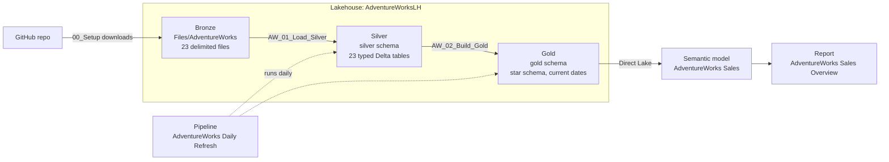

# Fabric AdventureWorks Lakehouse

A complete Microsoft Fabric demo you can stand up from one notebook: a medallion Lakehouse on the AdventureWorksDW sample data, a Direct Lake semantic model, a report, and a daily pipeline that keeps every date current so the demo always ends today. BEST DAY EVER!!!

## Quick start

1. Open a Fabric workspace that is on a capacity (a trial works).
2. Import [`NoteBooks/00_Setup.ipynb`](NoteBooks/00_Setup.ipynb) into the workspace.
3. Open it and select **Run all**. You do not need to attach a Lakehouse.

When it finishes, the last cell prints links to the Lakehouse and the report.

You need the Contributor role or higher in the workspace, and the notebook needs outbound internet access to download this repo from GitHub. The setup turns on a daily pipeline run; set `SCHEDULE_DAILY_REFRESH = False` in the first code cell if you do not want that. To build from your own fork, change `REPO` and `BRANCH` in the same cell.

## What it builds



| Item | Type | What it is |
| --- | --- | --- |
| `AdventureWorksLH` | Lakehouse | Schema-enabled Lakehouse holding all three layers |
| `AW_01_Load_Silver` | Notebook | Loads the files into typed Delta tables, then checks row counts, keys and relationships |
| `AW_02_Build_Gold` | Notebook | Builds the star schema and moves every date forward so the data ends today |
| `AdventureWorks Sales` | Semantic model | Direct Lake on OneLake, 10 tables, 16 measures, 3 row-level security roles |
| `AdventureWorks Sales Overview` | Report | One page: sales, margin, orders and growth by month, country and product |
| `AdventureWorks Daily Refresh` | Pipeline | Runs the two notebooks every day at 06:00 UTC |

Running the setup again updates these items in place.

## The three layers

**Bronze** is the files as they are in this repo, landed in `Files/AdventureWorks`.

**Silver** is one Delta table per file in the `silver` schema, with real data types. The load fails if a file has a bad row or a header that does not match, and the notebook then verifies row counts, key uniqueness and all 44 relationships.

**Gold** is a star schema in the `gold` schema, built for the semantic model:

- `FactSales` combines internet and reseller sales into one table with a `Channel` column.
- Product categories and customer and reseller geography are flattened into their dimensions, single-letter codes become words, and columns get friendly names.
- `DimDate` is generated, so it always holds whole calendar years. The fiscal year starts on July 1.
- Every date moves forward by a whole number of days so the data looks current:

| Data | Rule |
| --- | --- |
| Internet sales | The latest order date becomes today |
| Reseller sales and sales quotas | The latest reseller order date becomes today |
| Finance, call center, currency rates, inventory, survey | The latest date in each table becomes today |

The source data runs from late 2010 to mid 2014. Because the pipeline rebuilds gold every day, the dates keep rolling forward. To freeze the demo on a fixed day, set `AS_OF_DATE` in `AW_02_Build_Gold`.

## Semantic model and report

The model reads the gold tables with Direct Lake on OneLake, so there is no import and no refresh schedule: when the pipeline rewrites the gold tables, the model picks up the new data.

- **Tables:** Sales, Sales Quotas, Date, Product, Customer, Reseller, Employee, Promotion, Sales Territory, Currency.
- **Measures:** Sales Amount, Internet Sales, Reseller Sales, Order Quantity, Orders, Average Order Value, Customers, Total Cost, Gross Margin, Gross Margin %, Sales YTD, Sales PY, Sales YoY %, Sales by Ship Date, Sales Quota, Quota Attainment %.
- **Row-level security:** the roles `North America`, `Europe` and `Pacific` each limit sales to one territory group. To try one, open the model, select **Manage roles**, then **View as**. Roles apply to users with read access to the model; workspace Admins, Members and Contributors always see all data.

The model and report are stored as a Power BI project in [`PowerBI/`](PowerBI) (TMDL and PBIR), so every table, measure and visual is a readable text file. The setup notebook deploys them with the Fabric REST API and points the model at your Lakehouse.

## What is in the repo

| Folder | Contents |
| --- | --- |
| `AdventureWorks/` | 15 dimension and 8 fact tables as delimited text files |
| `NoteBooks/` | `00_Setup`, `01_Load_Silver` and `02_Build_Gold` |
| `PowerBI/` | Semantic model (TMDL) and report (PBIR) as a Power BI project |
| `Pipeline/` | Definition of the daily refresh pipeline |
| `PowerQueryTemplates/` | Dataflow Gen2 template that loads the same files with Power Query |
| `Views/` | T-SQL views that shift dates at query time, for the SQL analytics endpoint |
| `scripts/` | `validate_repo.py`, the consistency checks that run on every pull request |

## Other ways to use it

**Run the notebooks yourself.** Upload the `AdventureWorks` folder to `Files/AdventureWorks` in a schema-enabled Lakehouse, import `01_Load_Silver` and `02_Build_Gold`, set `LAKEHOUSE_NAME` in each, and run them in that order.

**Low-code load with Dataflow Gen2.** Create a Dataflow Gen2, choose **Import from a Power Query template**, and select `PowerQueryTemplates/AdventureWorksDataflowGen2.pqt`. It reads the 23 files straight from this repo and sets the data types; choose your own destination. Change the `BaseUrl` parameter to read from a fork.

**SQL views.** The scripts in `Views/` do the date shift at query time over the silver tables, using `GETDATE()`. Run them in the SQL analytics endpoint of the Lakehouse; run `vwFactResellerSales` before `vwRptEmployeeResellerSales`. They are the original approach in this repo and are handy for T-SQL demos, but Direct Lake cannot read views, so the semantic model uses the gold tables. One difference to know: `vwFactResellerSales` lines up the latest due date with today, so its latest order is 12 days earlier than in gold.

## Data file format

Every file in `AdventureWorks/` uses the same format:

| Setting | Value |
| --- | --- |
| Delimiter | pipe (`\|`) |
| Encoding | UTF-8, no byte order mark |
| Line endings | LF |
| Header | first row, column names match AdventureWorksDW |
| Quoting | none; a `"` in a value is literal text |
| Nulls | empty field |
| Dates | `yyyy-MM-dd` |
| Booleans | `true` / `false` |
| Numbers | plain decimals with a leading zero, no scientific notation |

Reading a file yourself:

- **Spark:** `sep="|"`, `quote=""`, `header=true`
- **Power Query:** `Csv.Document(file, [Delimiter = "|", Encoding = 65001, QuoteStyle = QuoteStyle.None])`

| Table | Rows | Key |
| --- | ---: | --- |
| DimAccount | 99 | AccountKey |
| DimCurrency | 105 | CurrencyKey |
| DimCustomer | 18,484 | CustomerKey |
| DimDate | 3,652 | DateKey |
| DimDepartmentGroup | 7 | DepartmentGroupKey |
| DimEmployee | 296 | EmployeeKey |
| DimGeography | 655 | GeographyKey |
| DimOrganization | 14 | OrganizationKey |
| DimProduct | 606 | ProductKey |
| DimProductCategory | 4 | ProductCategoryKey |
| DimProductSubcategory | 37 | ProductSubcategoryKey |
| DimPromotion | 16 | PromotionKey |
| DimReseller | 701 | ResellerKey |
| DimSalesTerritory | 11 | SalesTerritoryKey |
| DimScenario | 3 | ScenarioKey |
| FactCallCenter | 120 | FactCallCenterID |
| FactCurrencyRate | 14,264 | CurrencyKey, DateKey |
| FactFinance | 39,409 | FinanceKey |
| FactInternetSales | 60,398 | SalesOrderNumber, SalesOrderLineNumber |
| FactProductInventory | 776,286 | ProductKey, DateKey |
| FactResellerSales | 60,855 | SalesOrderNumber, SalesOrderLineNumber |
| FactSalesQuota | 163 | SalesQuotaKey |
| FactSurveyResponse | 2,727 | SurveyResponseKey |

Differences from the Microsoft original, all on purpose: the Spanish and French columns, the other translated product descriptions, and the image columns (`LargePhoto`, `EmployeePhoto`, `SalesTerritoryImage`) are left out, and so are the sales reason tables. Every remaining value matches the original, except a handful of names and addresses in `DimEmployee` and `DimReseller` where accented characters are garbled in the original and are correct here (for example `Königsteiner Straße`).

## Keeping the repo healthy

```
python scripts/validate_repo.py
```

This needs only Python. It checks every data file against the schema in the load notebook (format, data types, row counts, keys and relationships), that every JSON file and notebook parses, and that the report and the model's relationships and roles only use fields that exist in the model. GitHub Actions runs it on every pull request and on every push to `main`.

## Credits and license

The code in this repo is released under the [MIT License](LICENSE). The data is derived from Microsoft's [AdventureWorksDW sample](https://github.com/microsoft/sql-server-samples/tree/master/samples/databases/adventure-works/data-warehouse-install-script), also MIT licensed, copyright Microsoft Corporation. Thanks to MIM for help with the original load code.
